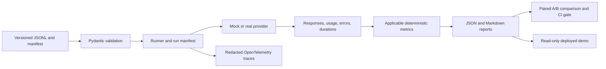

# Architecture and decisions

Status: proposed MVP architecture; modules are placeholders until implemented.

## Data flow

The Python CLI is the system of record. A web demo displays sanitized, precomputed
reports; it does not expose a public endpoint for spending API credits. Start
without a database, queue, orchestration framework, or live chat service.

## Module responsibilities

| File | Responsibility |
| --- | --- |
| schemas.py | Strict scenario, response, metric, and run contracts; JSONL loading |
| providers.py | Small provider protocol, mock, real adapter; no access to reference answers |
| runner.py | Execute cases; capture failures, timing, usage, reproducibility metadata |
| evaluators.py | Versioned deterministic checks; later separate judge adapter |
| report.py | Aggregation, readable reports, paired comparisons, regression decisions |
| telemetry.py | Trace lifecycle, redaction, optional export |
| cli.py | Arguments and exit codes; delegate business logic to modules |

## Contracts and boundaries

- Scenario IDs are unique within a versioned dataset. Hash the exact dataset
  bytes and record schema/dataset versions. References and rubrics are evaluator
  inputs, never inference inputs.
- The initial runner evaluates the next response after a fixed conversation.
  It is not a dynamic multi-turn simulator. Assistant history is fixture data.
- Providers receive messages and generation configuration only. Return response
  text, identity, optional usage, and finish information. Normalize timeout,
  transport, and provider failures. Bound timeouts and retries; log attempts.
- Every case yields a result, including failures. A metric has a name, version,
  applicability, result, and reason. Not evaluated is distinct from pass/fail.
- Capture dataset hash, code revision and dirty state, model identifier,
  generation settings, seed, metric versions, run ID, and dependency lock.
  Real providers may vary even with identical settings; retain raw responses.
- Measure local end-to-end durations with a monotonic clock. Keep provider
  usage separate from estimates. Missing cost stays unknown. Record pricing
  source/date if cost is calculated from a rate table.
- A/B uses the same cases and metrics. Show paired differences, missing results,
  error rate, and scored/total counts; ten cases cannot support broad superiority
  or multilingual safety claims. Mock measurements only validate plumbing.
- Default traces contain IDs, statuses, durations, and metric versions rather
  than prompt/response content or credentials. Export failure must not erase
  evaluation results. Use OpenTelemetry first; Langfuse integration follows
  when there is time and a configured destination.

## Testing and deployment

Unit tests cover schema rejection, adapter failures, metric applicability,
aggregation denominators, and gate failure. Integration tests run the entire
offline CLI with temporary files; paid APIs are opt-in and excluded from CI.
Deterministic mock baselines are distinct from real model baselines.

CI will install locked dependencies, run tests, validate the dataset, execute a
mock run, and enforce an intentional regression gate. Deployment initially serves
sanitized precomputed reports with no API keys in the frontend or artifacts.
Choose hosting after the offline pipeline works. Document deployment, update,
rollback, and a public smoke check before calling the demo deployed.

## Scope after the four-hour MVP

LLM-as-judge needs human labels, held-out calibration, agreement measurements,
and language-specific disagreement review. It remains experimental until those
exist. Speech evaluation, additional languages, live-run authentication, persistent
job storage, and production service operations are later work.
