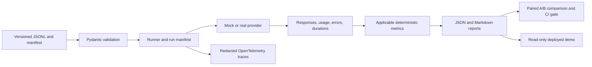

# Architecture and decisions

Status: implemented CLI-first MVP. See README.md for executed results and limits.
The demonstration frontend now has a separate hosted adapter and Render Blueprint.
Public mock deployment was verified at https://vaanibench-ai.onrender.com. New
durability extensions are included in this release; owner-live cloud configuration
and acceptance remain pending. The rubric judge is optional
and uncalibrated; human calibration remains later work.

## Data flow

The Python CLI is the system of record. The local demo calls the same runner,
receives progress callbacks, and serves artifacts without exposing a public
endpoint for spending API credits. The hosted adapter uses SQLite locally or
external PostgreSQL. No distributed queue or live chat service is introduced.

## Module responsibilities

| File | Responsibility |
| --- | --- |
| schemas.py | Strict scenario, response, metric, and run contracts; JSONL loading |
| providers.py | Small provider protocol, mock, real adapter; no access to reference answers |
| runner.py | Execute cases; capture failures, timing, usage, reproducibility metadata |
| evaluators.py | Versioned deterministic checks; later separate judge adapter |
| report.py | Aggregation, readable reports, paired comparisons, regression decisions |
| telemetry.py | Trace lifecycle, redaction, optional export |
| cli.py | Arguments and exit codes; delegate business logic to modules |
| costs.py | Versioned pricing, shared per-run attempt/USD ledger and reservations |
| credentials.py | Explicit, allowlisted environment-file loading without secret output |
| demo.py and web/ | Loopback HTTP adapter, bounded comparison jobs, progress and result interface |
| hosted.py | Starlette/Uvicorn adapter, exact public origin, auth/CSRF boundary, owner-only live jobs |
| hosted_auth.py | PBKDF2 owner password hashing and verification |
| hosted_state.py and storage.py | Shared SQLite/PostgreSQL sessions, ownership, jobs, artifacts, throttling, migrations, daily reservations |
| benchmark.py and calibration.py | Approval-gated repeated benchmarks, annotation packs, human/judge agreement |
| operations.py | Owner-only operational snapshot and threshold alerts over retained results |

## Contracts and boundaries

- Scenario IDs are unique within a versioned dataset. Hash the exact dataset
  bytes and record schema/dataset versions. References and rubrics are evaluator
  inputs, never inference inputs.
- The initial runner evaluates the next response after a fixed conversation.
  It is not a dynamic multi-turn simulator. Assistant history is fixture data.
- Providers receive messages and generation configuration only. Return response
  text, identity, optional usage, and finish information. Normalize timeout,
  transport, and provider failures. Bound timeouts and retries; log attempts.
- Live providers require explicit authorization and case selection. Generation,
  judge calls, and retries share a ledger: default $0.10 estimated USD and 20 HTTP
  attempts per run. Mock mode needs no key or pricing table. Model prices are
  validated before calling; token-derived costs remain estimates, not invoices.
- Every case yields a result, including failures. A metric has a name, version,
  applicability, result, and reason. Not evaluated is distinct from pass/fail.
- Capture dataset hash, code revision and dirty state, model identifier,
  generation settings, seed, metric versions, run ID, and dependency lock.
  Real providers may vary even with identical settings; retain raw responses.
- Measure local end-to-end durations with a monotonic clock. Keep provider
  usage separate from estimates. Missing cost stays unknown. Record pricing
  source/date if cost is calculated from a rate table.
- A/B uses the same cases and metrics. Show paired differences, missing results,
  error rate, and scored/total counts; ten cases cannot support broad superiority
  or multilingual safety claims. Mock measurements only validate plumbing.
- Default traces contain IDs, statuses, durations, and metric versions rather
  than prompt/response content or credentials. Export failure must not erase
  evaluation results. Optional OTLP/HTTP export uses a bounded batch processor
  and sanitized diagnostics. Real collector delivery still needs configuration.

## Testing and deployment

Unit tests cover schema rejection, adapter failures, metric applicability,
aggregation denominators, and gate failure. Integration tests run the entire
offline CLI with temporary files; paid APIs are opt-in and excluded from CI.
Deterministic mock baselines are distinct from real model baselines.

CI installs locked dependencies, runs tests, validates the dataset, executes a
mock run, and enforces an intentional regression gate. PostgreSQL contract and
mock browser jobs require no provider keys. Public deployment serves interactive
mock comparisons plus recorded evidence with no keys in frontend/artifacts.
render.yaml defines a single-instance public mock-only service. Deployment,
restart, rollback and public smoke checks are documented in deployment.md.
Live hosting requires owner authentication and external PostgreSQL or a confirmed
persistent SQLite disk. Reservations are committed atomically before transport.
PostgreSQL transaction advisory locks serialize writes; a dedicated session lease
allows one hosted instance across ephemeral directories. Transaction pooling is
unsupported. A lost lease stops subsequent model calls. No uncertain call is replayed.
Versioned migrations create control/artifact tables without clearing existing data.
Reports are committed with completion, so downloads survive local scratch loss.
Old SQLite file-only artifacts use a compatibility fallback. Job history is bounded
to 100; PostgreSQL retention is seven days, SQLite one hour. Daily reservations
remain independent of job/report cleanup. See reliability.md for failure limits.

## Scope after the four-hour MVP

LLM-as-judge needs human labels, held-out calibration, agreement measurements,
and language-specific disagreement review. It remains experimental until those
exist. Annotation/agreement tooling exists; independent labels do not. Dynamic
simulation and speech remain optional. External owner-live deployment, collector
verification, restore drills and operational maturity require explicit verification.
